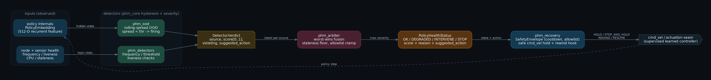
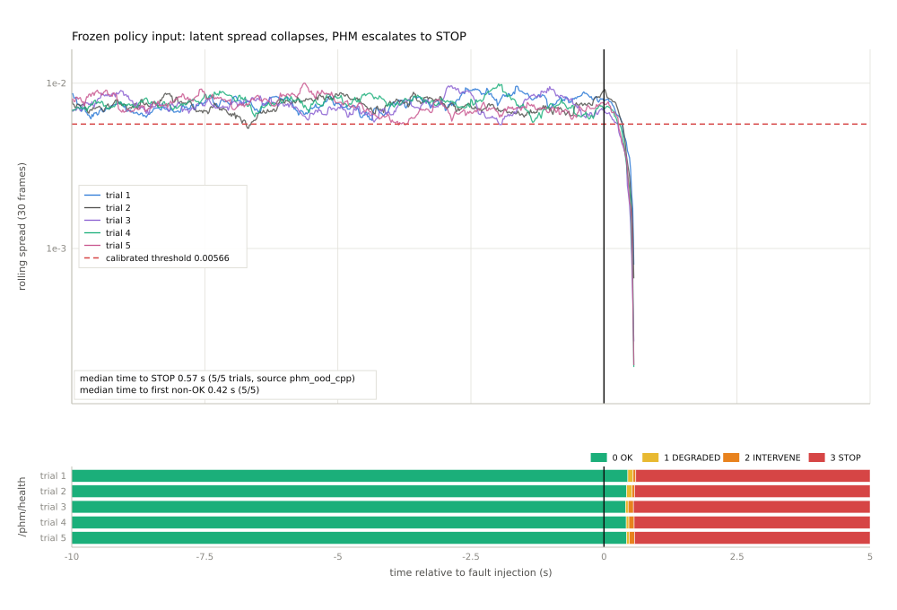
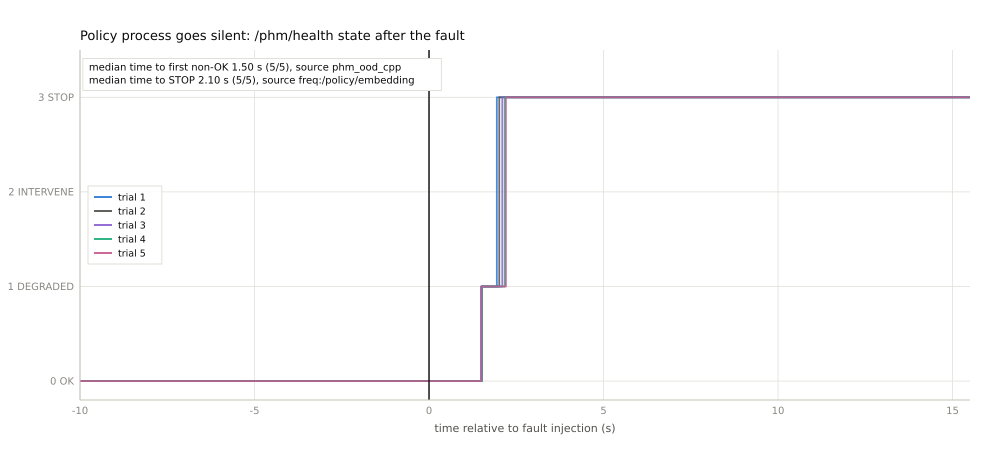
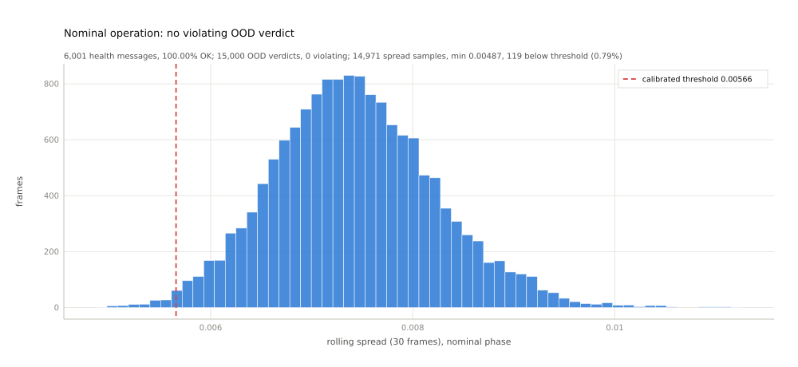

# Policy Health Monitor (PHM)

**A runtime watchdog for learned robot policies: it reads the policy's own internal
embeddings and raises `OK`, `DEGRADED`, `INTERVENE`, or `STOP` (each with a
human-readable reason and a recommended action) when the policy's internal state freezes
or collapses.** It is for engineers running a learned controller on a robot who need an
early health signal for it. On the robot PHM is advisory so far: its verdicts have not yet
been connected to anything that takes control away from the policy.

## What problem this solves

A learned policy has no error code. When it drifts out of distribution it keeps
publishing confident, well-formed commands, and the first visible symptom is the robot
already doing the wrong thing. A watchdog on the policy's *output* only fires after that
point, and a watchdog on the input images misses the case where the scene looks normal
but the policy's internal state has quietly frozen.

PHM taps the hidden state instead. It tracks the trace of the rolling covariance of the
policy embedding, so a frozen or collapsed internal state shows up as a variance drop
even though the embedding never leaves the in-distribution region. Detector verdicts,
node health, and sensor health are then fused by a worst-wins arbiter into one health
signal, with hysteresis so a single noisy frame does not stop the robot.



## Concrete example

A healthy policy stream, then the same policy collapsing at frame 200. The threshold is
calibrated on the healthy phase only, at its 1st percentile:

```cpp
#include "phm_core/calibration.hpp"
#include "phm_core/sim.hpp"

auto batch = phm_core::generate_embeddings(/*dim=*/64, /*n_frames=*/200, 1.0, 0.01, /*seed=*/42);
double threshold = phm_core::calibrate_threshold(phm_core::rolling_spread(batch.in_dist, 20), 1.0);

auto stream = phm_core::vstack({&batch.in_dist, &batch.ood});  // collapses at frame 200
std::vector<double> spread = phm_core::rolling_spread(stream, 20);  // NaN until the window fills
// spread[t] < threshold flags frame t as out of distribution
```

The complete program is `src/phm_core/examples/collapse_example.cpp`
(`phm_collapse_example`, also run as a test), and it prints:

```text
calibrated threshold   56.86
mean spread, healthy   61.87
mean spread, collapsed 0.01
first alarm at/after collapse   frame 200
false alarms on healthy frames  2 / 181
```

Two false alarms out of 181 healthy frames is what a 1st-percentile calibration is
supposed to produce; the hysteresis stage in `phm_core` exists to absorb exactly those. The
synthetic stream is the one `numpy.random.default_rng(42)` produces, and the threshold
and spreads are bit-identical to the NumPy implementation this C++ replaced.

## On a real robot

Four kinds of session, newest last: the first onboard session in shadow mode on a standing
robot (2026-10-06, below), a live-sensor stale-input check (2026-10-09), shadow mode on a
robot walking under its own controller (2026-10-17), and the Phoenix walking policy in
control of the robot with PHM advisory on its own latent (2026-10-17).

### First onboard session, shadow mode, standing robot, 2026-10-06

PHM has run on the onboard computer of a Unitree GO2 (aarch64, ROS 2 Humble), with all
10 packages of the 0.2.0 C++ tree built there with `colcon`. The watched policy was the
[go2-phoenix](https://github.com/yusufdxb/go2-phoenix) stand-v3 locomotion policy in
shadow mode: it read the robot's live `/lowstate` at 50 Hz, computed actions that were
never sent, and published its 384-D hidden-layer latent for PHM to score. The robot stood
still under its own controller (Unitree sport mode). Two
failures were then induced in software, 5 trials each: `freeze_obs` feeds the
policy a stale observation snapshot, and `stop` makes the policy process go silent.



| Measured on the GO2 | Result |
|---|---|
| Nominal, no fault, 300 s | 0 non-OK of 6,001 `/phm/health` messages; 0 violating of 15,000 OOD verdicts |
| `freeze_obs` fault | `STOP` in 5 of 5 trials; first violating OOD verdict at median 0.38 s; `STOP` at median 0.57 s, max 0.60 s |
| `stop` fault | `STOP` in 5 of 5 trials; first non-OK health at median 1.50 s; `STOP` at median 2.10 s, max 2.20 s |
| CPU in the nominal phase, % of one core | detectors 6.0%, C++ OOD node 1.4%, arbiter 1.3%, shadow policy 4.6% |
| Rolling-spread step, C++ `bench_latency`, D=384, W=30, 5000 frames, 3 runs per backend | plain backend p50 14.7 to 14.8 us, p99 15.8 us; Eigen backend p50 17.8 to 18.0 us, p99 18.7 to 21.8 us. The pre-migration C++ core measured plain p50 25.4 us and Eigen p50 48.2 us on the same computer |
| Shadow policy, ONNX Runtime C++ API on CPU, 1 thread, 10 s stats windows over the session (63 windows) | forward pass p50 0.079 ms (median over windows; window p50 0.06 to 0.19 ms), window p99 at most 0.43 ms; whole tick (observation, forward pass, publish) p50 0.15 ms. The 0.1.x Python node measured a forward pass p50 of 0.135 ms |

Latencies run from the moment the fault is injected (the shadow policy's log timestamp)
to the moment a separate subscriber receives the PHM message, both on the robot's clock,
so they include delivery and detector compute. The threshold (0.00566) is the 1st
percentile of the 30-frame rolling spread over 3,001 live latent frames recorded
at the start of the session. As a 1st-percentile threshold implies, the spread dipped below
it on 119 of 14,971 nominal frames (0.8%); none produced a violating verdict, because each
dip was either shorter than the OOD node's 3-frame hysteresis or too shallow to clear its
severity floor. In the `stop` fault the first non-OK message is the arbiter marking the
silent OOD source stale, so its time follows the arbiter's 1.5 s staleness limit (the
0.1.x session used 1.0 s and saw 0.99 s). The C++ benchmark times the detector core only
(`OodCore::update`), not DDS or executor time.





**What the 2026-10-06 run does not show.** The robot stood still; it did not walk. The policy ran in
shadow mode and never controlled the robot, and nothing in the session published a
command (`phm_recovery` was not launched). The threshold was calibrated, and the
false-alarm rate measured, on that standing-still state only. Both faults were induced in
software. `freeze_obs` holds the whole observation constant, including the policy's own
last-action term, so the latent becomes exactly constant, which is the easiest case for
this detector. `stop` removes the embedding stream, so it exercises liveness checks rather
than the latent statistics. This is not a real policy failing in the field, and it is not
evidence that PHM warns before a behavioral failure. One gap is known and open: a
rolling-spread collapse detector calibrated on a still robot can confuse "the robot is
still" with "the policy collapsed" when the robot goes from moving to still (later tested
on 2026-10-17: no alarm after 16 stops in shadow mode or 4 stops with the policy in control,
with a thin margin after the stops; see below). The opposite
change was seen once, in an earlier 0.1.x session calibrated with the robot lying down:
when the operator stood the robot up with the remote, the rolling spread peaked at about
80,000 times its lying-down median, then settled about 1.6 times higher while standing.
PHM stayed `OK` throughout (4,369 of 4,369 `/phm/health` messages; 0 of 10,922 OOD
verdicts violating). That is correct for a collapse detector, and it also shows the
detector's blind side: the test is one-sided, so a burst of variance never raises it.

**Bugs that only the robot found.** Running on the GO2 exposed three bugs the test suite
had missed, all fixed in commit `0c01a83`:

1. The arbiter crashed on the first live verdict. It set an attribute on the received
   message, and generated rclpy message classes use `__slots__`, so `/phm/health` had
   never been published on a real graph. The unit tests passed plain objects and could not
   see it. The arbiter is C++ now, and `phm_arbiter/test/test_arbiter_node.cpp` sends real
   `DetectorVerdict` messages over a live rclcpp graph and checks `/phm/health`.
2. The detectors node built its CPU, memory, and GPU-temperature checks but never fed
   them a reading.
3. The liveness and rate checks deserialized every message on the topics they watch,
   though they only need arrival times. Raw subscriptions cut the (then Python) detectors
   node from about 81% to 52% of one core with the 500 Hz `/lowstate` in the watched set.
   The C++ node keeps raw generic subscriptions.

How to reproduce the session, and exactly what publishes what, is in
[integrations/go2/README.md](integrations/go2/README.md).

### Live-sensor stale-input check, 2026-10-09

A later short session used the same stand-v3 shadow policy on live robot sensors while
an external operator retained control. Calibration collected 3,001 embeddings at
50.02 Hz, with a 30-frame window and a 1st-percentile threshold of 0.003588. During
60 seconds of nominal monitoring, all 1,200 health messages were `OK`, and none of
3,000 OOD verdicts violated the threshold.

One `freeze_sensors` trial froze the sensor observation terms while keeping the
shadow policy's previous-action term live. The first violating OOD verdict arrived
0.240 s after injection; health reached `DEGRADED` at 0.266 s, `INTERVENE` at 0.416 s,
and `STOP` at 0.566 s. These are single-trial observations, not a measured success
rate. Nominal CPU use, as percentages of one core, was 4.91% for the detectors,
0.96% for the arbiter, 1.11% for OOD, and 3.59% for the shadow policy.

`STOP` was a software health verdict only. No recovery node or motion-command
publisher ran, and cleanup left no PHM processes or `/phm/cmd_vel` publisher.
The session did not quantify the robot's trajectory or validate a walking policy in
control, physical recovery, or early warning of a real failure. The calibrated
threshold describes this particular shadow-policy sensor stream.

### Scripted walking and partial sensor faults, 2026-10-17

All motion in this session was scripted through the robot's own sport controller
(Unitree sport API `Move` at 20 Hz, `StopMove` between segments, speeds capped, auto
stop on stale state, tilt or low body height), with an operator holding the remote as
the stop. PHM ran passive: the stand-v3 shadow policy on live `/lowstate`, no recovery
node, no motion publisher. The shadow policy is not the controller that walked the
robot, so these numbers describe PHM watching a stand policy's latent on a walking
robot's sensors, not the walking controller's internal state.

| Run | Result |
| --- | --- |
| `freeze_sensors`, standing, 5 trials | `STOP` 5/5; first violating verdict median 0.38 s, `STOP` median 0.56 s (max 0.58 s) |
| Scripted motion, 352 s (forward and back 0.3 m/s, turns 0.5 rad/s, stops and restarts) | 7,045 of 7,045 health messages `OK`; 0 non-OK within 3 s of any of 16 stops or 16 starts. Measured: forward 0.22 m/s, back 0.16 m/s, turns 0.29 rad/s |
| `freeze_sensors` 6 s into a forward walk (measured 0.19 to 0.21 m/s), 5 trials | `STOP` 5/5; first violating verdict median 0.76 s, `STOP` median 0.78 s (max 0.82 s); 0 non-OK while walking before the fault |
| `gyro_stuck` while walking, 5 trials | stale-input check 5/5 at 0.12 s, `STOP` median 0.20 s. Latent detector: first violation 6.3 to 21.5 s after the fault, every time at least 1.5 s after the robot stopped |
| `joint_stuck` (one calf encoder) while walking, 5 trials | stale-input check 5/5 at 0.26 s, `STOP` median 0.42 s. Latent detector: 0/5 |
| Outside fault episodes (that session) | 264.6 s, 0 non-OK health, 0 of 16,443 stale-check verdicts violating |

Walking takes the shadow latent's rolling spread from about 0.008 at rest to 20 to 300;
it returns to the rest level within 1 to 5 s of a stop. Freeze faults during walking are
detected about 0.4 s later than standing because the 30-frame window must first flush
the moving frames.

The partial faults exposed a blind spot: a single stuck channel barely changes the
latent spread while the robot moves, so the latent detector sees it only after the
robot stops, or never. Replay on recordings of the Phoenix walking policy (model_2750)
gave the same result (`gyro_stuck` 0/9 and `joint_stuck` 0/9 detected during motion).
The added stale-input check (`StaleSignalAdapter`, embedder parameter `stale_check`)
flags a gyro group or a joint's q and dq that repeat exactly for more than 5 or 12
ticks. The limits were set from the longest healthy repeat in two standing sessions
(1 and 6 ticks) before any held-out data was scored; on 0.51 h of held-out healthy
recordings (walking included) it raised no alarm, with a longest healthy run of 7 ticks.
It only detects values held exactly; a sensor that drifts, saturates or adds noise
while stuck is not covered.

The dead-topic adapters fired 2 s after startup in every earlier session, before DDS
discovery completed (2 to 3 s). `dead_startup_grace_sec` (5 s for the GO2) removed
these alerts in both later sessions.

### Phoenix model_2750 in control: stand and short walks, 2026-10-17

The robot was driven by the Phoenix walking policy (model_2750, ONNX Runtime on the
onboard computer, one `/lowcmd` writer, the sport controller released) through the
Phoenix FREE_FLOOR harness. An operator held the remote as a deadman. Each run had the
same sequence:

- from lying down, a scripted 2 s joint-space ramp to the default stance (Kp 60, Kd 5);
- the policy in control: 5 s of standing (drill), or about 4 s standing, a 0.3 m/s
  forward command for 2 s, then a stop and about 4 s standing (walk);
- a scripted sit.

**The policy did not stand the robot up.** It was trained from resets near the default
stance, so the stand-up is a scripted posture ramp (estimated body height 0.05 to 0.27 m,
peak tilt 6.5 to 9.3 degrees), not a learned transition.

PHM watched the executing policy's own latent. The policy node published its 384-D
hidden layers to `/policy/embedding`, with live parity checks against a separate ONNX
session. It used the fixed threshold from the 2026-10-06 stands, the stale-input check
on `/lowstate` (`phm_go2_stale_monitor`) and the dead-topic and rate detectors.
`phm_recovery` was not running. PHM was advisory only, and nothing it published reached
the robot. The script is `phoenix_live_session.sh`. The tables cover five runs with both the
policy log and the PHM bag: one drill and four walks. Later drills that only gated a
walk are not included.

| Item | Result |
| --- | --- |
| Policy runs | 1 drill (250 ticks at 50 Hz) and 4 walks (549 to 551 ticks); no fall, no abort during policy control, 0 action-limit or slew clips |
| Distance (tape, 3 walks) | 34.0, 27.4 and 36.8 cm forward against 0.60 m commanded (46 to 61 percent); sideways -0.6, +4.4 and under 1.3 cm. The first measured walk was taken at the head, the other two at the rear feet. Heading was not measured. The earliest walk had no tape |
| Latent stream | 2,444 of 2,450 published latents recorded (the 6 missing are the first 3 of two runs, before the recorder subscribed); every live parity check passed; offline replay from the logged observations matched the recorded latent within 1.2e-6 and the logged action within 4.8e-7 |
| False alarms | 0 of 2,445 latent-detector verdicts and 0 of 2,451 stale-check verdicts violating while the policy was in control; arbitrated health `OK` throughout (standing, walking, after the stop) |
| Latent spread, rolling, W=30 | standing before the walk min 0.0086 to 0.0097; walking min 0.0089 to 0.0163; after the stop min 0.0071 to 0.0083, with 5 to 66 frames below the threshold (0.00857) in each walk. None became a violation: the core reports one only when the score also reaches the `DEGRADED` band (spread under about 0.0064) |
| Timing | Policy session p50 0.23 to 0.25 ms, p99 1.7 to 3.4 ms, max 16 ms; latent publish p50 0.41 to 0.44 ms. Interval between logged ticks p99 22 to 26 ms, 3 to 7 over 25 ms per walk, max 47 ms. These are late ticks, not lost periods: the timer woke with p99 20.4 to 21.4 ms and a mean rate of 49.9 to 50.1 Hz, and no command sequence number was skipped. The delay is work inside a tick (median 2 ms, occasionally 8 to 33 ms) |
| PHM CPU, onboard | 14 to 16 percent of one core in total: recorder 3.9 to 4.7, detectors 4.1 to 4.8, stale check 3.3 to 3.9, arbiter 1.1 to 1.4, OOD node 0.7 to 0.9 |

**Offline fault replay.** The faults were synthetic and applied to the recorded
observations at the middle of each phase, never on the robot. The deployed detectors
and limits were used, with no recalibration. Freeze faults ran the policy open loop on
its own action. All five runs give 5 stand phases; the four walks give 4 walk and
4 after-stop phases. The table shows first-violation latency in seconds.

| Fault | Standing | Walking | After the stop |
| --- | --- | --- | --- |
| `freeze_obs` | latent 0.34 to 0.48, stale 0.12 | latent 0.62, stale 0.12 | latent 0.30 to 0.48, stale 0.12 |
| `freeze_sensors` | latent 0.36 to 0.48, stale 0.12 | latent 0.68 to 1.94, stale 0.12 | latent 0.28 to 0.52, stale 0.12 |
| `gyro_stuck` | latent 0.54 to 5.96, stale 0.12 | latent 2.40 to 3.48, stale 0.12 | latent 0.44 to 0.58, stale 0.12 |
| `joint_stuck` (FL calf) | latent never, stale 0.26 | latent never, stale 0.26 | latent never, stale 0.26 |

The healthy replay of the same runs gave 0 violations in every phase, so these latencies
are not inherited alarms.

**Faults that are not exact freezes** were replayed the same way: the raw readings were
changed and the observation rebuilt with the robot's own builder. The detectors were not
recalibrated, and the severities were fixed before any result. Each fault ran from the middle
of every phase in all five runs, 13 episodes per severity and 312 in total. "Action change"
is the largest change in the policy's output, in action units (scale 0.25 rad), within 1 s
of the onset.

| Fault (3 severities) | Latent detector | Stale-input check | Action change |
| --- | --- | --- | --- |
| Gyro bias drift, 0.1 to 2 rad/s per s | 0 of 39 | 0 of 39 | 0.04 to 1.26 |
| FL calf encoder drift, 0.05 to 1 rad/s | 0 of 39 | 0 of 39 | 0.04 to 1.41 |
| Gyro clipped at 0.05 to 0.5 rad/s, or FL calf dq clipped at 0.5 to 5 rad/s | 0 of 78 | 0 of 78 | 0 to 0.16 |
| Gyro held with noise, sigma 0.005 to 0.1 rad/s | 2 of 39 (7.3 and 8.6 s) | 0 of 39 | 0.01 to 0.34 |
| FL calf held with noise, sigma 0.0005 to 0.01 rad | 0 of 39 | 0 of 39 | 0.003 to 0.28 |
| All sensors held for 3 / 8 / 15 of every 25 ticks | 0 / 4 / 11 of 13 | 0 / 13 / 13 of 13 (0.12 s) | 0.006 to 0.73 |
| One-tick gyro spike of 1 to 20 rad/s every 25 ticks | 0 of 39 | 0 of 39 | 0.35 to 6.9 |

Both detectors look for one thing: an input or a latent that stops changing. A sensor that
drifts, saturates, spikes or stays noisy keeps the latent moving, so neither detector sees
it, even when the policy's output moves by up to 6.9 action units (1.7 rad of joint target).

What this does not show:

- that the policy can stand up;
- walking beyond 2 s at 0.3 m/s, turning, other speeds or terrain;
- a measured body velocity (the onboard odometry was not available with the sport
  controller released; the tape is the only displacement measure);
- a real failure, or any fault on the robot while the policy was in control;
- whether the after-stop margin holds on longer stands. The raw spread went below the
  threshold in every walk, so the margin to the severity floor is small.

## Status and verified numbers

| Item | Value |
|---|---|
| Test suites | colcon on Humble: 267 tests in 10 packages, 0 failures (gtest, including live rclcpp-graph tests of the detectors, OOD, arbiter and recovery nodes, plus ament lint). Standalone CMake, no ROS: 20 CTest entries (145 gtest cases and the README example), 0 failures |
| ROS 2 graph | 10 `ament_cmake` packages build with `colcon` on Humble; the install overlay passes `scripts/check_install_overlay.sh`. On the GO2's onboard computer (aarch64) the C++ tree builds 10/10, `phm_core` (160 tests) and `phm_go2` (35 tests) pass, and an offline replay of the shadow policy matches the desktop reference (sensor observation terms bit-identical, action and latent within 2e-6) |
| Benchmark: collapse failure | PHM AUROC 1.000 (95% CI [1.000, 1.000]), FPR@95 0.000. Best baseline is KNN at AUROC 0.419; the rest are 0.03 to 0.12 |
| Benchmark: shift failure | PHM AUROC 1.000, and Mahalanobis, Relative Mahalanobis, unnormalized KNN and both RND forms also 1.000 |
| Detector cost | Benchmark: 0.54 us per frame, fit and score amortised over the stream, median of 30 repeats (C++, [benchmark/RESULTS.md](benchmark/RESULTS.md)). Detector core per frame (`bench_latency`, D=384, W=30, plain backend, desktop x86-64): p50 3.9 to 4.0 us, p99 4.4 to 5.1 us over 3 runs; the pre-migration C++ core measured p50 7.4 us on the same machine. On the GO2's onboard computer: p50 14.7 to 14.8 us, p99 15.8 us over 3 runs, against p50 25.4 us for the pre-migration core |
| End-to-end chain | Isolated localhost graph on a desktop x86-64 machine, synthetic 50 Hz embeddings, D=384, 500 Hz auxiliary topic, `scripts/measure_chain.sh`: embedding to OOD verdict p50 0.08 ms, p99 0.17 to 0.22 ms, 4850 of 4850 verdicts received (two runs); fault to `/phm/cmd_vel` zero velocity 0.48 to 0.49 s (mostly window refill and hysteresis); each C++ node 0.2% to 1.0% of one core and 24 to 28 MB RSS, against 1.7% to 6.4% and 58 to 63 MB for the Python nodes it replaced. The same isolated graph on the GO2's onboard computer (one run, 5 trials): embedding to OOD verdict p50 0.19 ms, p99 0.37 ms, 4850 of 4850 verdicts received; fault to `/phm/cmd_vel` zero velocity 0.47 s in 5 of 5 trials; each node 0.3% to 2.2% of one core and 10 to 13 MB peak RSS. That `/phm/cmd_vel` reached nothing; the recovery output has not been connected to the robot |
| Data used | Benchmark: synthetic policy streams. On the robot, shadow mode: the 384-D latent of the go2-phoenix stand-v3 policy on live `/lowstate`, with the robot standing (2026-10-06), under external operator control (2026-10-09), and walking under the Unitree sport controller (2026-10-17). In control: the 384-D latent of the Phoenix walking policy model_2750 while it controlled the robot for one stand and four 2 s walks (2026-10-17), plus offline fault replay on those recordings |
| Hardware validation | Partial. Shadow-mode onboard build, CPU cost, nominal health output, time to software `STOP` for `freeze_obs`, `stop`, `freeze_sensors`, and, during scripted walking, `freeze_sensors`, `gyro_stuck` and `joint_stuck`; 352 s of scripted walking, turning and stopping with no alarm ([On a real robot](#on-a-real-robot)). With the Phoenix walking policy in control (advisory PHM on its own latent): 1 stand drill and 4 short forward walks with 0 false alarms, and synthetic faults replayed offline on those recordings. Not done: a policy-driven stand-up, longer or turning walks with a policy in control, a fault while the policy is in control, a real (not induced) failure, physical recovery, early warning before a behavioral failure |
| Release | 0.2.0 (2026-10-06): the C++ runtime and the first onboard GO2 session; see [CHANGELOG.md](CHANGELOG.md) |

## Packages

| Package | Role |
|---|---|
| `phm_msgs` | ROS 2 messages: `PolicyHealthStatus`, `PolicyEmbedding`, `DetectorVerdict`. |
| `phm_core` | ROS-independent C++ library: detector interface, hysteresis, severity bands, rolling-spread calibration, the OOD core (plain / Eigen / optional LibTorch kernels), health detectors, worst-wins arbitration, recovery logic, synthetic streams, NumPy-compatible random streams and `.npy` / `.npz` I/O. Builds with plain CMake as well as colcon. |
| `phm_tools` | Header-only offline helpers: JSON, SVG charts, and a small MLP trainer for the benchmark and demo. No ROS dependency. |
| `phm_detectors` | Topic-rate, dead-topic and host CPU / memory / GPU-temperature detectors; the node watches topics with raw generic subscriptions (arrival times only). |
| `phm_ood` | The OOD lifecycle node with the `phm_ood` interface (configurable topic, `.npz` calibration file, `embed_dim`, source `phm_ood`). |
| `phm_ood_cpp` | The OOD lifecycle node with the `phm_ood_cpp` interface (`ood_node`, source `phm_ood_cpp`), the lifecycle node library both interfaces share, and `bench_latency`. |
| `phm_arbiter` | Worst-wins arbiter that fuses detector verdicts + node/sensor health into one `PolicyHealthStatus` (total ordering, stale-critical safety). |
| `phm_recovery` | Safe-fallback layer (`cmd_vel` hold + rewind hook), actuation off unless `recovery.enabled` is true. |
| `phm_sim` | Synthetic policy-stream publisher for end-to-end tests, and `phm_chain_bench`, which times a running graph from embedding to verdict, health and recovery output. |
| `phm_go2` | [`integrations/go2/`](integrations/go2/README.md): runs PHM onboard a Unitree GO2 with a shadow-mode policy (ONNX Runtime C++) that publishes a real policy latent, a probe that calibrates PHM and records its output, a session runner that injects faults, and tools that reduce a session to numbers and figures. Nothing in it commands the robot. |

Every package is C++ (`ament_cmake`). The repository contains no project Python; ROS 2's
own tooling (`ros2 launch`, `ros2 lifecycle`, colcon, rosidl's generated message bindings)
is used as shipped.

The full signal flow, including the recovery layer, is also available as a vector image
in [docs/architecture.svg](docs/architecture.svg).

## Benchmark

The PHM OOD detector is benchmarked against Mahalanobis, Relative Mahalanobis, KNN, and
RND (closed-form and a gradient-trained MLP) on two synthetic failure families. Metrics are
threshold-free (AUROC, AUPR, FPR@95TPR) with stratified-bootstrap 95% CIs. Full numbers
and methodology in [benchmark/RESULTS.md](benchmark/RESULTS.md). The benchmark is C++
(`benchmark/`, binary `phm_benchmark`); its seeded streams and bootstrap resamples are the
ones the original NumPy harness drew, and every AUROC, AUPR, FPR@95 and CI bound matches
the NumPy / PyTorch harness it replaced at the printed precision
(`scripts/check_benchmark_reproduces.sh` re-checks this in CI).

Headline: on the **collapse** failure (a frozen, low-variance embedding) the PHM
rolling-spread detector is perfect (AUROC 1.000, FPR@95 0.000) while every location-based
baseline is at or below chance (AUROC 0.03 to 0.42). A collapse is a second-order anomaly
(within-window variance drops while the embedding's location does not move), so first-order
location detectors are structurally blind to it. On the **shift** failure both the location
baselines and PHM are perfect. The two scenarios make the contrast explicit; PHM covers the
failure mode the standard baselines miss. Both scenarios are synthetic, so these numbers
bound the detector's structural coverage, not its accuracy on a real policy.

## Installation

### ROS-independent library and tools (CMake)

`phm_core` (with `phm_tools`, the benchmark, the demo and the GO2 session tools) builds
without ROS. Requirements: a C++17 compiler, CMake 3.16 or newer, zlib, Eigen 3 and
GoogleTest (`sudo apt install cmake g++ zlib1g-dev libeigen3-dev libgtest-dev`).

```bash
git clone https://github.com/yusufdxb/policy-health-monitor.git
cd policy-health-monitor
cmake -S standalone -B build/standalone -DCMAKE_BUILD_TYPE=Release
cmake --build build/standalone -j
ctest --test-dir build/standalone --output-on-failure
```

To use the library from another CMake project, install it and use `find_package`:

```bash
cmake -S src/phm_core -B build/phm_core -DCMAKE_BUILD_TYPE=Release
cmake --build build/phm_core -j
cmake --install build/phm_core --prefix /opt/phm
```

```cmake
find_package(phm_core REQUIRED)        # CMAKE_PREFIX_PATH=/opt/phm
target_link_libraries(my_target phm_core::phm_core)
```

### ROS 2 graph (colcon)

On a sourced ROS 2 Humble environment:

```bash
source /opt/ros/humble/setup.bash
rosdep install --from-paths src integrations --ignore-src -y --rosdistro humble
colcon build --cmake-args -DCMAKE_BUILD_TYPE=Release
source install/setup.bash
scripts/check_install_overlay.sh
```

The overlay check resolves every package through the ament index, checks that every
executable is installed with all its shared libraries resolvable, that the launch files
and configs are installed, that no project Python was installed, and that a CMake
consumer of `phm_core` builds and runs. The GO2 shadow-policy node is built only when
ONNX Runtime (`-DONNXRUNTIME_ROOT=...`) and Unitree's `unitree_go` messages are found; see
[integrations/go2/README.md](integrations/go2/README.md).

Each node package ships an XML launch file:

```bash
ros2 launch phm_detectors detectors.launch.xml
ros2 launch phm_arbiter arbiter.launch.xml staleness_sec:=2.0
ros2 launch phm_ood phm_ood.launch.xml threshold:=0.019 window:=30
ros2 launch phm_recovery recovery.launch.xml    # recovery.enabled: false by default
ros2 launch phm_sim sim.launch.xml
```

### Running the OOD detector

`ood_node` (package `phm_ood_cpp`) and `phm_ood_node` (package `phm_ood`) are managed
lifecycle nodes, so they do not publish until configured and activated. Parameters are
read once in `on_configure`:

```bash
ros2 run phm_ood_cpp ood_node --ros-args -p window:=30 -p threshold:=0.05
# in another shell:
ros2 lifecycle set /phm_ood_cpp configure
ros2 lifecycle set /phm_ood_cpp activate
```

Embedding frames that arrive while the node is not ACTIVE are not scored. Deactivating
`ood_node` clears the rolling window so a re-activation never blends pre- and
post-activation state; `phm_ood_node` keeps its window until cleanup, as it always did.
The spread kernel is selected with `PHM_BACKEND=plain|eigen|libtorch`; unset, the node
prefers Eigen when it was built. On both the GO2 and a desktop x86-64 machine the plain
kernel measured faster, and it reproduces NumPy's arithmetic exactly, so
`PHM_BACKEND=plain` is the recommended setting.

### Non-finite inputs

The OOD detector never scores a window whose rolling spread is NaN or Inf as in
distribution. Because `NaN < threshold` evaluates false, a naive threshold comparison would
pass exactly the input a broken upstream policy emits. The shared C++ detector core tests
the spread for finiteness first and returns a verdict with score 0.5 (`BAD_INPUT_SCORE`,
the intervene boundary), no suggested action, and the reason
`non-finite spread: embedding contains NaN or Inf`. The verdict is marked non-violating,
since a non-finite embedding is a detector-health fault rather than evidence of OOD, and it
is cached so the frequency gate carries it forward instead of replaying the last good
verdict. `phm_core/test/test_ood_core.cpp` covers it.

Limit: the arbiter does not escalate a fresh non-violating verdict (a fixed rule since
0.1.0), so this verdict is visible on `/phm/verdicts` but leaves `/phm/health` at `OK`. The
same holds for the dimension-mismatch and oversized-embedding verdicts. A consumer that
needs to act on bad input must watch `/phm/verdicts` for these reasons. Raising bad-input
verdicts to a health degradation is an open design decision, not current behavior.

## Development

```bash
# ROS-free build and tests
cmake -S standalone -B build/standalone -DCMAKE_BUILD_TYPE=Release
cmake --build build/standalone -j && ctest --test-dir build/standalone --output-on-failure

# ROS 2 packages: gtest on live rclcpp graphs, cpplint, xmllint
source /opt/ros/humble/setup.bash
colcon build --cmake-args -DCMAKE_BUILD_TYPE=Release
colcon test && colcon test-result --verbose

# Repository checks (also run in CI)
scripts/check_public_hygiene.sh
scripts/check_no_project_python.sh
scripts/check_benchmark_reproduces.sh build/standalone/benchmark/phm_benchmark

# End-to-end timing of the running chain on this machine (isolated, synthetic input)
source install/setup.bash && scripts/measure_chain.sh /tmp/phm_chain
```

The decision logic was ported from a Python implementation and checked against it before
that implementation was removed: the OOD core, health detectors, arbiter and recovery
logic produced identical verdicts, states, scores and reason strings on randomized
scenarios, and the random streams, rolling spread and calibration reproduce NumPy
bit for bit. The tests pin those behaviors with fixtures.

## What is not verified yet

The benchmark numbers come from synthetic policy streams. The on-robot numbers come from
shadow-mode sessions on one GO2, standing and during scripted walking under the robot's
own sport controller, and from five short runs with the Phoenix walking policy in control
(one stand, four 2 s forward walks at 0.3 m/s). Not yet verified:

- a walking policy in control beyond those five runs: longer walks, turns, other speeds,
  and a stand-up by the policy itself (the stand-up was a scripted ramp)
- any fault on the robot while a policy is in control: the faults for the policy-in-control
  runs were replayed offline
- a real policy failure, rather than an induced one
- whether PHM warns before a behavioral failure
- the moving-to-still transition for the walking policy's own latent beyond four stops:
  none raised an alarm, but the raw spread dipped below the threshold after every stop
- sensor faults that are not exact freezes: in offline replay on the walking policy's own
  runs, neither detector caught drift, clipping, noisy holds or spikes at any tested
  severity, standing or walking (table above). This needs a different kind of check, for
  example whether redundant readings agree
- the recovery layer acting on the robot: `phm_recovery` has run on the onboard computer only
  in the isolated synthetic graph above, and its `/phm/cmd_vel` has never reached the robot
- a second robot

## License

MIT, see [LICENSE](LICENSE).
